  

 

# 👋 Hi, I'm Sumeet Awantgi

### AI & ML Enthusiast | Developer | Engineering Student

  

---

## 🚀 About Me

* 🎓 AIML Engineering Student at PDA College of Engineering.
* 💻 Interested in Artificial Intelligence and Machine Learning.
* 🌱 Currently improving my programming and development skills.
* 🔭 Working on AI-powered projects like Cura AI.
* 🎯 Passionate about technology, creativity and innovation.
* 🤝 Always open to collaborating on interesting projects.

---

## 🛠️ Languages & Technologies

---

## 📊 GitHub Statistics

---

## 🏆 GitHub Trophies

---

## 🔥 GitHub Contribution Streak

---

## 🐍 Contribution Snake

<picture>
  <source media="(prefers-color-scheme: dark)" srcset="https://raw.githubusercontent.com/Sumeetawantgi/Sumeetawantgi/output/github-snake-dark.svg">
  <source media="(prefers-color-scheme: light)" srcset="https://raw.githubusercontent.com/Sumeetawantgi/Sumeetawantgi/output/github-snake.svg">
  
</picture>

---

## 🚀 Featured Projects

<table>
<tr>
<td width="50%">

### 🩺 Cura AI

AI-Powered Personal Health Copilot.

- Medical document analysis
- AI-powered health insights
- Gemini API integration

**Tech:** Python | Streamlit | Gemini

<a href="https://github.com/shriraksha-deshp/Cure-AI">
View Project →
</a>

</td>

<td width="50%">

### 🎥 HYPOGRAPHYYY

Personal creative portfolio.

- Photography portfolio
- Cinematic videography
- Responsive website

**Tech:** HTML | CSS | JavaScript

<a href="https://github.com/Sumeetawantgi">
View GitHub →
</a>

</td>
</tr>
</table>
---

## 🌐 Connect With Me

---

### 💭 Developer Quote

*"Great things are built one line of code at a time."*

**Thanks for visiting my profile! 🚀**

